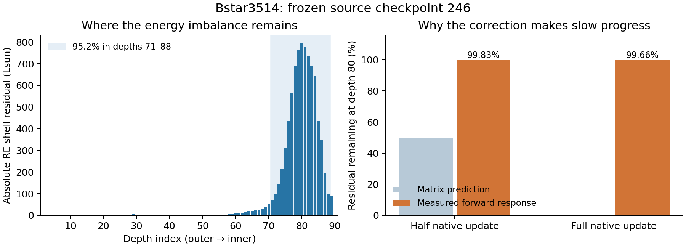

# Bstar3514 deep thermal slow mode — 7 November 2026

Scope: identify why the post-Ng run makes very slow thermal progress, and test a
bounded remedy. The original model is stopped at checkpoint 246 after interruption
restored its accepted batch. Do not converge or overwrite this original model.
The original model and installed native solver remain unchanged. A guarded global
extrapolation policy is implemented and registered after passing six full native
follow-up solves and a fresh saved-state radiation audit. The remaining energy
error decreases by about 18%; the native Jacobian itself is not repaired.

## Starting evidence

Fresh zero-solve radiation at saved 246 gives 92,506.5371 Lsun against an imposed
inner luminosity of 84,000.0193 Lsun (10.1268% excess). Its signed RE residual is
-8,241.3245 Lsun; 95.19% of its absolute residual lies in depths 71–88 and 72.38%
in depths 77–85. The RE/wind-corrected consistency luminosity is 84,380 Lsun.
The original leftover OBSFLUX belongs to the discarded partial batch, so use
`model_Bstar3514_energy_audit_246` for consistent saved-state measurements.

The right panel compares the same native correction direction at depth 80.
The half-step uses a fresh frozen-state transfer calculation; the full-step
measurement uses the next native residual inside the ordinary continuation.

The logged discrepancy declines from 10.63546% at solve 230 to 10.15587% at 246:
only 4.51% of the remaining error is removed in sixteen full solves, an empirical
347-solve e-folding time over this window. Deep T requests are fully applied:
at depth 80, -0.004431% or about -1.52 K per solve at T=34,376 K. Local damping
RELAX=0.125 acts at depths 26–30 and does not directly clip this deep correction.
The largest population correction remains the nearly absent implicit O VI at
54; it is not a measure of the thermal error. The bounded Ng step improved the
state but did not cure the continuing slow thermal convergence rate.

## Matched saved-state comparison

Each branch starts at the same checkpoint 246; the values below come from fresh
radiation after two full solves, rather than pre-update native log values.

| Branch | Surface luminosity excess | Absolute RE residual (Lsun) | Coordinates above 1% | Verdict |
| --- | ---: | ---: | ---: | --- |
| Starting saved 246 | 10.12680% | 8,417.50 | 3,095 | Baseline |
| Ordinary continuation | 10.06910% | 8,370.01 | 3,041 | Slow control |
| EHB temperature equation | 10.11384% | 8,330.45 | 235 | Reject: little thermal progress |
| Tighter BA/weak-line cutoffs | 10.06857% | 8,402.25 | 3,267 | Reject: negligible flux gain, worse corrections |
| Positive global extrapolation | 8.37073% | 6,971.79 | 1,391 | Retained gain; six-solve validation passes |

## Experimental protocol

All cases clone checkpoint 246 with fixed source inputs, geometry, abundance,
convergence tolerances and damping. Native revision remains 2026-11-02.1.
Full solves run serially because a full matrix solve uses about 11 GiB memory.
Each matched full-solve branch initially receives two fresh-BA/free-T solves.
Native Ng is disabled in both branches to avoid a second extrapolation confound.
Source hashes, complete correction evidence and conservation checks are retained.
No original controls/checkpoints are modified.

1. `model_Bstar3514_thermal_ordinary_246`: ordinary two-solve control.
2. `model_Bstar3514_thermal_ehb_246`: change only USE_EHB/COMP_EHB to T;
   test the native electron-heating-balance temperature equation.
3. `model_Bstar3514_thermal_diff01_246` and `*_diff05_246`: laboratory-only
   fixed-opacity diffusion-gradient proposals. Hold T fixed through depth 74
   (Rosseland tau 9.844), and integrate d(T^4) inward with its gradient scaled
   by target/local luminosity. Mix 0.1 or 0.5 of this correction, giving maximum
   T changes of 0.11423% and 0.57113%. Populations, Ne, element totals, geometry
   and native counters remain unchanged. These are proposals, not solved states.
   Zero-solve radiation probes measure the nonlinear response before any full
   follow-up. Such a proposal is not accepted on flux improvement alone.

A first draft diffusion constructor refused an overly broad monotonicity check
because the original shallow profile already has inversions. It failed before
publishing anything. Its unseeded copy `*_thermal_flux01_246` was consequently
used only as a reproducibility control: its fresh radiation agrees exactly
with the original 246 audit. The corrected constructor requires monotonicity
only in the deep region it actually changes, preserving all shallower values.

## Mechanism audit

The native executable restricts NUM_BNDS to 1 or 3. The current three-band
operator linearizes J using adjacent-depth population/temperature derivatives,
while the forward transfer remains global. This is an approximate Newton
operator, not a full global Jacobian. The response tests below demonstrate a
poor operator for this state; they do not by themselves identify a unique
Fortran implementation error.

Fresh-only native runs do not retain BAMAT even with STORE_BA requested, so the
initial BAMAT watcher was stopped. Instead the deep thermal rows were recovered
from BCSCRATCH/DSCRATCH: undo the LU pivots and row/column equilibration to recover
the Schur row, then undo block elimination. Stored population vectors must match
checkpoint 246, and every sequential-record marker and source file identity is
checked. Only depths 71–90 were captured; no running input was changed.

An independent reconstruction check multiplies these recovered rows by the
actual 246-to-247 native correction. It cancels the full-precision RE residual
to approximately 1e-11 relative at interior deep layers (about 2.5e-9 at the
inner boundary). Thus the matrix reconstruction and sign convention agree with
the actual solved system; the linear system itself is being solved accurately.

The matrix nevertheless predicts the *forward* temperature response poorly.
For the 0.11423% deep-T perturbation, the relative L2 error of the predicted RE
change is 1.419 over depths 71–89. At depths 75 and 77 its predicted change has
the opposite sign to the actual forward change. The inner-boundary response is
about 33.6 times its prediction. A five-times-larger perturbation gives almost
five times the same response, so large-step nonlinearity is not the explanation.
At depth 71, all temperature variables within the retained adjacent-depth band
are unchanged and the predicted response is zero, but the forward residual
changes: this directly demonstrates off-band temperature/radiation coupling.

Both temperature-only proposals fail the thermal screen. The 0.11423% case
moves emergent luminosity by only -0.929 Lsun but raises the absolute RE residual
from 8,417.50 to 45,988.55 Lsun. The 0.57113% case moves luminosity by -4.646 Lsun
and raises the residual to 196,582.22 Lsun. This rejects a temperature rescaling
alone, and demonstrates the need to correct temperature and populations together.
It does not establish how a separately re-equilibrated population state would
behave at that temperature profile.

A private laboratory executable is linked in `/private/tmp` against the installed
libraries, using a copy of cmfgen_sub.f. Its sole hook writes the frozen populations,
RE residual and electron-energy residual before output-only exit, and is enabled
only by a marker in the owned test directory. Installed Fortran sources and the
production executable are unchanged. Its unperturbed forward flux must match the
unmodified executable before its residual probes can support an interpretation.

The earlier BA_CHK_FAC=1e-4 experiment at 206 was inconclusive because it ran out
of disk before the first solve. Source inspection shows that this cutoff gates
selected population-rate response terms; thermal-row accumulation is separate.
It therefore cannot be assumed to fix the thermal mode without a measured test.

## Status

The ordinary two-solve control finished at checkpoint 248. Its requested maximum
corrections are 2.38539% and 2.37919%; the pre-update luminosity excess changes
from 10.12680% to 10.09791%. Element densities and charge agree within 2.9e-15,
and controls remain unchanged. A separate zero-solve audit of saved checkpoint
248 gives 92,458.0643 Lsun (10.06910% excess) and absolute RE residual
8,370.0149 Lsun. These saved-state values include both control updates; the
native log values describe the state before each update.
The matched EHB branch has completed and is not accepted as a remedy for this
thermal stall. The selected positive global extrapolation passes six ordinary native follow-up
solves and a fresh saved-252 audit. The implemented acceptance validator approves
it; the automatic policy is now registered locally. The tighter-cutoff branch
is rejected below. No step is applied to the original model.

The first EHB solve takes about 44 minutes versus about 29 minutes for the
first ordinary solve (these timings include competing read-only radiation
probes, so they are not isolated benchmarks). Its largest correction rises to
21.15595% at depth 1. Requested temperature changes switch from -0.0033434% to
+1.53% at depth 1 and from -0.0044149% to +0.0015939% at depth 80.

Its second maximum correction settles to 1.92157%, with only 235 coordinates
above 1% versus 3,041 in the ordinary control. Yet its fresh saved-248 luminosity
is 92,495.6485 Lsun (10.11384% excess), versus 92,458.0643 (10.06910%) for
ordinary continuation. Absolute RE residual is 8,330.4502 Lsun; its signed
residual is -8,330.1038, so removing positive residuals explains much of the
absolute improvement while the large negative imbalance remains. The normalized
luminosity maximum is 1.1025 versus the starting 1.1026 and ordinary 1.1021.
Thus the improved population metric does not establish thermal convergence.
The EHB two-solve branch takes about 82 minutes versus 64 for ordinary, with
different competing diagnostic probes, and makes less surface-luminosity progress.
This rejects it as the present bounded thermal remedy, not as a universal claim
that EHB can never converge. Species/charge comparisons pass at 2.6e-15, and
controls remain unchanged. Its numbered LU scratch (10.74 GB) is reclaimed only
after the independent fresh audit, preserving checkpoint and control hashes.

### Coupled-step confirmation

A zero-solve probe at half of the actual native 246-to-247 update confirms the
mismatch in the solver's own direction. The recovered matrix predicts that half
the update removes exactly 50% of the deep RE residual. The actual remaining
fraction is 99.76% at depth 71, 99.83% at depth 80 and 100.13% at depth 89.
This is a weak approximate response, not failure of the block linear solver.
The half-step changes emergent luminosity from 92,506.5371 to 92,494.3916 Lsun
and absolute RE residual from 8,417.50 to 8,405.59 Lsun.

Decomposing the *predicted* native full-step energy-row response at depth 80
gives populations +1.0017271e9, Ne +5.1178237e6, and T -2.2692316e5, summing
to +1.0066180e9 raw residual units. Thus populations supply 99.5% of that
predicted cancellation. This is a coupled radiation/rate/temperature bottleneck;
a temperature-only partial-derivative check cannot establish the entire cause.

### Inner-boundary derivative check

Source inspection found that the diffusion-gradient normalizer omits the direct
superlevel line-opacity temperature derivative. A private experimental addition
of that term was tested with central differences at T(ND)*(1 +/- 1e-4), stopping
after normalization and before any population solve. Forward DTDR is unchanged.
The original relative derivative error is 0.096827%; including the term reduces
it only to 0.095075%. This is a real omission but not a sufficient explanation
or demonstrated remedy for the much larger global thermal response error.
The experimental change has not been installed in the production source/binary.

### Fixed-factor and full-step checks

Additional probes hold the unperturbed Eddington factors fixed, separating their
variation from omitted depth coupling. The relative L2 temperature-response error
is 1.41898 with fixed factors versus 1.41902 with fresh factors. The wrong-sign
predictions at depths 75 and 77 and the off-band response at depth 71 remain.
Refreshing the factors is therefore not a demonstrated cure.

The native full update is independently checked inside the ordinary two-solve
batch, where factors are retained. Its matrix predicts essentially complete
removal of each captured deep residual, but the actual fractions remaining are:

| Depth | Residual remaining after native full update |
| --- | ---: |
| 71 | 99.5201% |
| 75 | 99.5055% |
| 80 | 99.6622% |
| 85 | 99.9922% |
| 89 | 100.2330% |
| 90 | 100.2118% |

The printed STEQ precision limits this comparison's prediction to about 2e-5
relative; the independent full-precision reconstruction check above establishes
that the actual linear solve cancels the starting residual much more accurately.
No matrix rows outside captured depths 71–90 are inferred.

### Single-layer derivative check

With the same compatible unperturbed Eddington factors fixed, two zero-solve
probes change only T at depth 80 by relative +1e-5 and +1e-4. Every other stored
population is identical. The relative L2 discrepancy between the actual and
stored derivatives at retained depths 79–81 is 0.1417584 and 0.1417604.
The measured derivative changes only 1.07e-5 relatively between amplitudes,
excluding perturbation-size noise as an explanation for this 14.18% discrepancy.
At depth 80 the actual/matrix derivative ratio is 1.18677; at 79 it is 1.17125,
and at 81 it is 0.994665. There are also substantial omitted responses: depth
78's raw derivative is 35.15% of the depth-80 diagonal magnitude.

Both retained approximations and omitted depth coupling are therefore present;
the broad perturbation error must not be attributed exclusively to band width.
Source inspection shows that `do_var_cont.f` excludes WEAK_LINE contributions
from both population variations and its INCLUDE_dSLdT temperature branch.
The tighter WK_LIM experiment directly tests this approximation. It has not yet
proved that weak-line omission alone causes the complete slow mode.

### Positive coupled extrapolation screen

A separate laboratory proposal uses the last four conserved checkpoints
246–243, the native weighted absolute-population normal equations and the actual
10-depth bands, but reconstructs populations geometrically in log coordinates.
Every species is normalized back to its original total, and electron density is
recomputed from charge. This is a new experimental operator, not a native Ng
step or an extension of the tested bounded affine operator.

Backoff to alpha=1/8 keeps all coordinate ratios within [0.42168, 1.08234] and
the maximum temperature change at 0.31432%. Element totals agree within 2.4e-15,
charge agrees to floating-point precision, geometry and native checkpoint
counters are unchanged. The zero-solve forward residual probe reduces luminosity
from 92,506.5371 to 91,616.8320 Lsun, or excess from 10.12680% to 9.06763%.
Absolute RE residual decreases from 8,417.50 to 8,326.54 Lsun (1.08%), much less
than the signed residual improvement. Thus some residual is redistributed;
luminosity alone would overstate the benefit. This band10 seed was not selected
for full continuation because the global-band candidates improve the absolute
residual substantially more.
This band10 candidate is not applied to the original model or selected for
automatic use; the registered operator uses one global band instead.

A read-only native-affine preview at checkpoint 246 tests depth bands 5, 10,
15, 18, 30, 45 and 90. Every band still produces inadmissible negative populations
at many depths. Changing the native band alone does not remove this rejection.
A second positive geometric proposal uses one global 90-depth band; alpha=1/8
gives coordinate ratios [0.46867, 1.06250], maximum temperature change 0.26996%,
element conservation within 2.7e-15 and exact computed charge. Its independent
zero-solve screen checks whether removing coefficient discontinuities between
bands improves the residual distribution. Luminosity excess falls to 9.26666%
and absolute RE residual to 7,735.8852 Lsun (8.10% improvement).

A line-search screen doubles the common fraction to alpha=1/4, retaining
population ratios inside 0.1–10 and limiting T changes below 1%. Actual ratios
are [0.21965, 1.12872], maximum T change 0.53919%, element-density error
1.9e-15 and computed charge error zero. Its luminosity excess is 8.41246% and
absolute RE residual 7,111.9141 Lsun (15.51% reduction). Both merits improve over
alpha=1/8. This global alpha=1/4 seed, `*_thermal_logng90a4_246`, is selected for
ordinary native continuation after EHB; no unselected positive seed has received
a full solve. The selected proposal remains provisional through six full solves.

The laboratory reusable operator replays this selected seed byte-for-byte.
Eight real-checkpoint checks cover replay, positivity, species and charge
conservation, constant-history refusal, changed geometry/density/charge,
nonpositive histories, temperature-regime changes and direction reversal.
Application-level exact replay and fault-injection checks also pass: descriptor
tampering, low space, staging ENOSPC, cancellation and concurrent input changes
refuse publication; a post-publication fault restores the byte-exact original
through the real controller recovery path. Attempt receipts survive rollback.
These checks are not evidence of eventual convergence.
Scripts, checksums and private diagnostic-source hooks are archived under
`model_Bstar3514_energy_audit_246/reproduction`; the installed native executable and original model are unchanged.

### Tighter native linearization test

`model_Bstar3514_thermal_accuracy_246` starts from the original unseeded 246
state and tightens BA_CHK_FAC from 1e-3 to 1e-4 and WK_LIM from 0.10 to 0.01.
The native `ba_update_v7.f` comment describes 1e-4 as usual for its passed
derivative cutoff; `rd_control_variables.f` suggests 0.01 for the weak-line
opacity ratio. These change the numerical rate/transfer response approximation,
not luminosity, abundances, geometry, damping or convergence tolerance.

Two full solves and their fresh saved-state audit are complete. Luminosity is
92,457.6195 Lsun (10.06857% excess), practically identical to the ordinary control
at 10.06910%. Absolute RE residual is worse: 8,402.2510 versus 8,370.0149 Lsun.
The largest corrections rise from 2.54936% to 3.11741%; 3,267 coordinates exceed
1%, versus 3,041 in the ordinary control. Controls and conservation checks pass.

Its recovered thermal matrix passes the same reconstruction checks, but the
retained T80 derivative discrepancy worsens to 57.97% from 14.18%. The native
full update leaves 99.5530% of the depth-80 residual, versus 99.6622% for ordinary
continuation. This rejects the combined cutoff adjustment as a remedy for this
state and does not isolate either cutoff as the sole cause.

### Selected global seed: retained progress

After two full solves, fresh saved-checkpoint 248 radiation gives 91,031.4335
Lsun (8.37073% excess) and absolute RE residual 6,971.7868 Lsun. The ordinary
matched branch gives 10.06910% and 8,370.0149 Lsun. The global seed thus retains
about 17% less thermal error, with fewer significant population corrections:
1,391 coordinates above 1%, versus 3,041 in the ordinary branch. Solver maxima
settle from 2.43255% to 1.96416%; all significant-count comparisons improve.

Four full solves have now completed at saved checkpoint 250. Final-pair solver
maxima are 1.81146% and 1.76301%; uncapped metrics are 1.88% and 1.84%. The
boundary output profile has maximum 1.0848 and absolute RE residual 6,954.6657
Lsun. Boundary output precedes the final saved-state update, so it is not a
fresh checkpoint-250 audit. Conservation agrees within 3e-15 and controls are
unchanged. These intermediate values are superseded by the final fresh audit
below.

The ordinary decay rate after extrapolation remains slow. The remedy bypasses
the slow coupled mode with guarded extrapolation; it does not repair the native
Jacobian. Automatic use therefore needs observed ordinary progress between
trials, meaningful retained thermal improvement, and rollback on failure. A
single successful trial cannot guarantee eventual convergence.

### Final six-solve acceptance

All six ordinary follow-ups finish at saved checkpoint 252, without native Ng,
Lambda/fixed-T fallback, source/hydro/grid changes or major-species clipping.
Solver maxima across the three pairs are 2.43255, 1.96416, 1.81146, 1.76301,
1.73592 and 1.72368%. The final uncapped extrema are 1.81% and 1.80%, below
the starting 2.52%. Counts above 1% fall from 3,095 to 1,262; all significant
threshold counts improve.

Fresh checkpoint-252 radiation gives **90,961.8493 Lsun**, against the unchanged
84,000.0193 Lsun target: **8.28789% excess**, down from 10.12680%. Absolute
RE residual is **6,902.9955 Lsun**, down from 8,417.5045 Lsun. The reductions
are 18.16% and 17.99% respectively. The normalized luminosity maximum falls
from 1.1026 to 1.0842; its deviation improves 17.93%. Element totals agree
within 2.7e-15 and charge within 8.9e-16. The actual installed final validator
accepts all final criteria against the coherent starting baseline.

`model_Bstar3514_energy_audit_246/global-six-solve-acceptance.json` records
the validator result, earlier pair evidence, fresh merit, source hashes and
unchanged executable identity. The original remains byte-identical at 246.
Only generated numbered LU scratch in the completed owned branches is removed
after verification, reclaiming 10.74 GB per branch while preserving checkpoint
and control hashes; the selected case records `scratch-cleanup.json`.

The normal registered policy order also selects `global_ng` on an isolated
real-checkpoint replay with authenticated accepted history and coherent fresh
246 diagnostics. Its alpha=1/4 is computed by the general caps, not hard-coded
for this model. Operator replay still exactly matches the native-tested seed.
No attempt is made to fully converge either the original or experimental model.

### Automatic implementation and verification

The registered `global_ng` policy precedes the smaller affine fallback. It requires
six consecutive observed fresh-BA/free-T solves with fixed structure, complete
temperature vectors, stable target luminosity, a same-sign surface flux error
of at least 2%, and no more than 5% relative reduction over the window. The
normalized profile must still deviate by at least 5%, and inner Rosseland optical
depth must be at least 50. Population correction maxima must remain between
`max(0.1%, 5*EPS_TERM)` and 10%, with a final/initial ratio of 0.9–1.01.
Unsupported native families, temperature cycling and recent native transitions
refuse the trial. The native affine fallback must be limited to alpha <=1/16;
this rule does not replace admissible native acceleration.

The positive operator uses one global coefficient fit, every population
coordinate, species renormalization and charge-derived Ne. Common backoff
limits every population/Ne ratio to 0.1–10 and temperature change to 1%. It
changes only the selected population block and leaves geometry, other records
and native counters unchanged. The caller retains a durable coupled snapshot.

Three pairs of two ordinary native solves temporarily disable native Ng,
Lambda scheduling and automatic temperature switches, require free T and fresh
BA/radiation, and restore temporary switches on every exit. Final acceptance requires
settled population maxima and nonincreasing significant counts, conserved
geometry/elements/charge, and at least 10% improvement in **both** absolute RE
residual and the largest normalized luminosity deviation. Failure restores
the entire conservative checkpoint and controls; unknown failures stop for
review. No population floors or stopping-test exclusions are used.

At least eight newly observed healthy ordinary full solves separate attempts;
the old affine fallback cannot interrupt this cooldown. Trial solves do not
count toward it. After six healthy post-trial observations, the policy can
permit ordinary continuation through the bounded cooldown rather than have a
generic stall rule stop before the eighth observation. Repetition still needs
the complete slow-tail prerequisites. A durable checkpoint fingerprint prevents
same-checkpoint retries after rollback, even across invocations. There are at
most three trials per invocation, with nine remaining iterations/four attempts
required for each. Independent convergence verification remains mandatory.

The final registered-policy regression selection passes **374 tests**, covering
operators, independent direction guards, acceptance/rollback, repeated use after
cooldown, native control restoration and existing automatic/affine behavior.
The broader runner/automatic/checkpoint suite records 742 passes and one skip.
Two initial failures are outside the changed logic: a transient macOS `psutil`
process-arguments error during cancellation (the full 28-test performance file,
isolated cancellation and final registered selection pass), and an existing
warning-text expectation in `test_runner_restart`. The latter
reproduces individually; its test and implementation files are identical to
HEAD. No activity guard was weakened. Compilation and model/parser/public
documentation smoke checks pass.

### Post-trial handoff and independent direction checks

At saved checkpoint 252, native BW_NG=10 still rejects 48 depths, including
10 temperature-direction reversals. A 90-depth affine fit rejects 34 depths
but has no T reversals. Native acceleration therefore cannot yet be assumed
to take over. A read-only geometric preview has alpha=1/2, ratios
0.16099–1.16012 and maximum T change 0.66113%, with conserved species/charge
and no reversed global T step. It has not been applied or given convergence
credit; its forward merit and native follow-up remain untested.

This exposed an unnecessary eligibility dependency: the independent global
fit inherited the banded affine proposal's direction veto. The shared affine
diagnostic now optionally reports those reversals, while affine publication
keeps its original veto. The geometric operator independently refuses any
reversal of its own T step and retains every other history/conservation/cap
check. Its original checkpoint-246 result still exactly reproduces the
six-solve tested seed. A real checkpoint-252 isolated-copy audit confirms
that native affine publication remains refused while the global proposal is
available for a future provisional trial. Synthetic tests cover both this
separation and refusal of an actual global direction reversal. No additional
step is applied merely because its mathematical preview is admissible.

## Authenticated restart diagnosis

The runner now reuses accepted history before its first new full batch. New
accepted-state records use content hashes, including large checkpoint files,
controls/source inputs, executable and declared atomic data. Existing automatic
journals are accepted only when their rolling recovery, selected checkpoint,
input bundle and native/dependency identities match. Incomplete provenance
uses ordinary observations; no historical convergence flag can certify the
new invocation. Global-Ng cooldowns and persistent attempt receipts survive
restarts without spending the new invocation's iteration budget on old solves.

The original Bstar3514 checkpoint 246 authenticates accepted ordinary batches
238 and 246. Its leftover radiation output needs refresh. In an isolated copy
with those original journals, the new installed native output-only protocol
completes in about 4.5 minutes, preserving all restart files and temporary
controls. Startup diagnosis immediately selects `global_ng`, alpha=1/4, before
any ordinary population solve. The test stops at that decision; it applies no
remedy and earns zero full-iteration credit. Original checkpoint/control
hashes remain identical. Evidence is retained in
`model_Bstar3514_restart_history_audit_246/restart-native-proof.json` and
`restart-native-result.json`. No new convergence campaign is performed.

Once the accepted post-refresh record is saved, another isolated restart selects
`global_ng` in 1.87 seconds locally, without repeating the radiation pass. It
again stops at diagnosis with zero solved iterations and no applied remedy;
`restart-fast-proof.json` records the result. This is a measured local timing,
not a guarantee for other disks or machines.

Restart validation includes 388 passing affected-suite tests and a separate
52-test focused restart/advisory selection. These cover copied checkpoints,
source/data/executable edits, malformed histories, legacy interrupted tails,
independent verification, no LTE/POP reseeding of continuations, transition
boundaries, rollback, cancellation/timeout and native-attempt accounting.
The broader selection had 873 passes and one skip; three old expectations of
no startup action were updated to permit justified fresh-Jacobian verification
and pass in the affected rerun. The previously identified baseline warning-text
test remains separately excluded. Compilation, viewer/parser/public-documentation
smoke checks and diff checks pass. `validation.json` and `original-preservation.json`
in the restart audit directory retain the final records. Original model 246 is
unchanged; no native source/executable modification or full solve was needed.

## Retaining provisional verification across interruption

The interrupted production-style trial demonstrated an avoidable loss of work:
its four fully checked follow-up solves were discarded when the sixth solve
stalled. The runner now stores the last completely checked `global_ng` pair
separately from its conservative rollback snapshot. The model still rolls back
on interruption, and matching baseline diagnostics are restored too. A later
restart may restore the saved provisional pair and execute only the remaining
checks. Four retained full solves require two more; an unfinished pair is repeated.
No extrapolation is applied again and no prior solve spends the new invocation's
iteration budget or certifies convergence.

Resumption requires the original conservative checkpoint and controls to match
exactly, unchanged source/executable/atomic identities, intact snapshot hashes,
the same policy version, confirmed completed-pair checks in the source journal,
and a cleanly interrupted owner with successful rollback. It refuses newer
accepted progress, changed inputs, numerical rejection, incomplete archives and
insufficient verification budgets. There are at most two resumptions per trial.
Final rejection still restores the original conservative state. Full acceptance
and independent convergence verification retain their original criteria.

This change is prospective: the earlier interrupted run did not record these
snapshots, so its discarded provisional state cannot be reconstructed by the
new mechanism. The active ordinary run is left untouched. Saving checked pairs
does not diagnose or repair the native OpenMP synchronization stall itself.

Validation: 306 affected regression tests and 105 final integrity/restart tests
pass. They cover one- and two-pair resumption, repeated interruption, unchanged
attempt receipts, remaining-work budgets, exact rollback after final rejection,
refusal of newer progress or changed data, policy/source-journal checks, path
and manifest corruption, snapshot ENOSPC and failure after provisional state
publication. One earlier broad-run macOS process-inspection error passed in an
isolated rerun; activity guards were unchanged. Compilation, diff checks and
viewer/parser/documentation smoke checks pass. Records are retained under
`model_Bstar3514_energy_audit_246/reproduction/trial-resume-validation/`.
These controller tests use isolated native-layout fixtures; no additional full
CMFGEN solve or modification of the active model was performed for this change.
