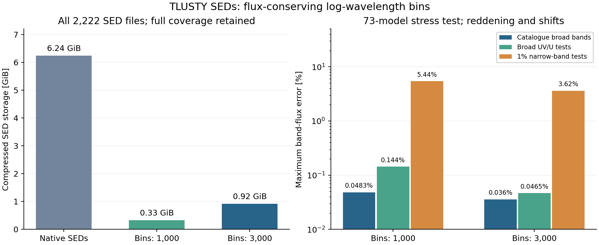

# TLUSTY broad-SED rebinning investigation

Date: 2026-11-10.

Flux-conserving rebinning on a logarithmic wavelength grid is a useful way to
reduce the broad SED cache while retaining its complete wavelength coverage.
A binning power of **lambda / bin width = 3,000** is the preferred starting point
for broadband photometry. Across all 2,222 local SEDs it reduces compressed
storage from **6.239 GiB to 0.916 GiB**, an **85.32%** reduction.

The experiments were read-only and did not change model indexes, raw archives,
or cached spectra. The validated algorithm is now available in the converter as
the opt-in `--sed-binning-power` option. The investigation script imports the
same bin integrator used by conversion. See the [grid workflow](../../MODEL_GRIDS.md)
for conversion and restoration commands.



## Native sampling and meaning of resolution

The published SEDs retain the model-atmosphere frequency points. Their sampling
is irregular and follows the atomic transitions; there is no single native
Gaussian resolving power or fixed wavelength increment. The local files span
approximately 45–114 Angstrom at the blue end, depending on the atmosphere, to
300 microns. The [OSTAR SED documentation](https://tlusty.oca.eu/tlusty/Tlusty2002/OS02-SED.html)
describes this frequency grid and explicitly discusses resampling it.

The experiment uses logarithmic bin edges, so delta-lambda/lambda is approximately
constant. Here **binning power** means lambda / bin width. It is deliberately
distinct from the detailed-spectrum converter's Gaussian instrumental
R=lambda/FWHM and its samples-per-FWHM option. A binning power of 3,000 does not
mean adding a Gaussian at instrumental R=3,000.

## Method and validation scope

The prototype integrates the native, piecewise-linear F-lambda spectrum over
each output bin, then divides by the bin width. Integrals are accumulated locally
to avoid cancellation of faint IR contributions against the much larger UV
integral. It preserves original wavelength endpoints and float64 values, and
does not upsample an already sparse SED. Both candidate settings retained 285
already-sparse files unchanged.

The exact bin integrals conserve native total flux to floating-point precision
(maximum relative discrepancy below 7e-16 in the full survey). For compatibility
with the current viewer, bin means are represented at their geometric centers,
with original endpoint samples added. The viewer linearly interpolates these
samples. That reconstruction is an additional approximation, and the tests
measure its photometric error rather than assuming bin conservation alone is
sufficient. This distinction is also relevant to established
[flux-conserving resamplers](https://specutils.readthedocs.io/en/stable/api/specutils.manipulation.FluxConservingResampler.html).

Two experiments were run:

1. **Full survey:** all 2,222 SEDs, at redshift 0 and E(B-V)=0, for binning powers
   1,000 and 3,000. Actual compressed sizes were measured in memory; no replacement
   NPZ files were installed.
2. **Stress comparison:** 73 atmospheres (37 BSTAR and 36 OSTAR), stratified over
   composition, microturbulence, temperature, and gravity, including parameter and
   sample-count extrema. Redshifts were -0.02, 0, +0.02; E(B-V) was 0, 1, 3.
   Methods included conservative bins, point interpolation, Gaussian convolution
   followed by resampling, and the existing 20,000-point selection control.

Both use the viewer's exact band-integration routine and extinction law. The
band set comprises its 15 catalogue bands (Gaia, Pan-STARRS, 2MASS, WISE), broad
UV test bands centered at 1,500 and 2,300 Angstrom, a broad U test band at 3,531
Angstrom, and ten diagnostic bands with width 1% of their central wavelength.

These are rectangular bands, matching the current viewer. This is not a
validation against measured transmission curves, arbitrary user passbands, or
the entire continuous range of redshift/extinction settings. The UV tests are
diagnostic bands, not measured GALEX response functions.

## Full-cache results

All errors below are relative band-flux errors against integration of the full
native SED. Percent values have already been multiplied by 100.

| Binning power | Compressed size | Reduction | Mean stored points | Maximum catalogue error | Maximum broad UV/U error |
|---|---:|---:|---:|---:|---:|
| Native | 6.239 GiB | — | Model-dependent | Reference | Reference |
| 1,000 | 0.326 GiB | 94.78% | 10,331 | 0.00895% | 0.04128% |
| 3,000 | 0.916 GiB | 85.32% | 29,471 | 0.01196% | 0.02264% |

Band-edge alignment makes individual errors nonmonotonic with binning power;
the slightly larger catalogue maximum at 3,000 is not a failure of global flux
conservation. Both maxima are small compared with 1% photometric errors.

## Reddening and redshift stress comparison

| Binning power | Maximum catalogue error | Maximum broad UV/U error | Maximum diagnostic narrow-band error |
|---|---:|---:|---:|
| 1,000 | 0.04825% | 0.14404% | 5.44% |
| 3,000 | 0.03597% | 0.04654% | 3.62% |
| 10,000 | 0.03598% | 0.00941% | 0.75% |

The largest narrow-band errors occur near the Lyman edge/strong UV features.
These settings should therefore be described as broadband-SED options, not as
replacements for detailed spectroscopy or arbitrary narrow-band photometry.
Keeping additional native samples around discontinuities is a possible future
improvement; it was not included in these numbers.

Some reddened IR errors plateau as sampling becomes finer. Resampling an
interpolated native SED and then applying extinction does not exactly commute
with the existing procedure of applying extinction to sparse native samples and
then interpolating. The tests intentionally include this consumer behavior.

Simple interpolation at bin centers is substantially less reliable: at binning
power 1,000 its maximum broad UV/U error was 12.17%, compared with 0.144% for
conservative binning on the same output coordinates. Narrow absorption features
must contribute their integrated area even when no output center lands on them.

A limited grid-ranking check used the same 73 atmospheres, fixed redshift and
extinction at zero, a fitted free normalization, and 1% errors. It tested 73
noiseless synthetic observations plus three noise realizations per atmosphere
(219 noisy observations; random seed 20261110). Neither conservative setting
changed the best candidate compared with native integration. This does not
establish invariance of a full fit with free extinction, redshift, broadening,
or different error bars.

## Related issue: the previous 20,000-point photometric fitting limit

The previous native TLUSTY fit path selected at most 20,000 points before the
photometric integrator receives the model. For SEDs, selection by array index
can leave very large wavelength gaps in sparsely sampled IR regions. Later
flux-conserving photometric integration cannot recover points already discarded.

In the 73-model control, this thinning produced a maximum catalogue-band error
of **40.89%** (WISE W3, S37500g350v10, z=-0.02, E(B-V)=3). It changed the selected
candidate for 13/73 noiseless and 41/219 noisy observations in the limited
ranking check. This is an existing fitting-path issue, not a consequence of the
proposed SED rebinning or the user's running detailed-spectrum conversion.

The production path now bypasses this thinning for all TLUSTY photometric fits,
including native SEDs. Resolution-controlled or SED-binned candidates also retain
their deliberately chosen sampling. The legacy control in the investigation
script remains available to reproduce the original issue.

## Implementation and remaining limits

- The independent, opt-in `--sed-binning-power 3000` setting leaves the detailed
  Gaussian resolution setting separate. A 1,000 setting is an aggressive option
  for broad-band work with a looser UV tolerance.
- Conversion preserves full wavelength coverage and both original endpoints.
  Sparse models retain native sampling when binning would not reduce the sample count.
- Conversion rebuilds from raw archives when settings change, retaining the ability
  to restore native sampling. Record the binning method/power separately from
  Gaussian instrumental resolution in files and indexes.
- The fitter bypasses the 20,000-point cap for rebinned SEDs and native TLUSTY
  photometry. Display downsampling remains separate.
- Rebinned SEDs are photometry-only fitting products. Detailed `.7` spectra remain the line-fit
  products. Additional checks are needed for narrow-band or spectral use.
- Before enabling any default reduction, validate the user's actual passbands,
  fitting bounds, and photometric precision. The present experiments support an
  optional broadband setting, not a universal lossless replacement.

## Reproduction

Run from the repository root; all input cache access is read-only:

```bash
# Stratified stress comparison and limited grid-ranking check.
python3 scripts/investigate_tlusty_sed_rebinning.py --models-per-grid 32

# All SEDs, native frame, no reddening; conservative candidates only.
python3 scripts/investigate_tlusty_sed_rebinning.py \
  --models-per-grid 0 --binning-powers 1000 3000 \
  --conservative-only --unreddened-only \
  --output tmp/tlusty-sed-rebinning/all-models.json

python3 -m pytest tests/test_tlusty_sed_rebinning.py -q
```

Results, including tested model names and worst-error contexts, are written to
`tmp/tlusty-sed-rebinning/summary.json` and `all-models.json`. This directory is
gitignored. Five mathematical/regression checks cover area conservation,
coverage, narrow-line integration, faint IR precision, and free normalization.
